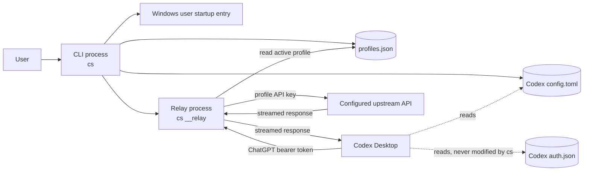
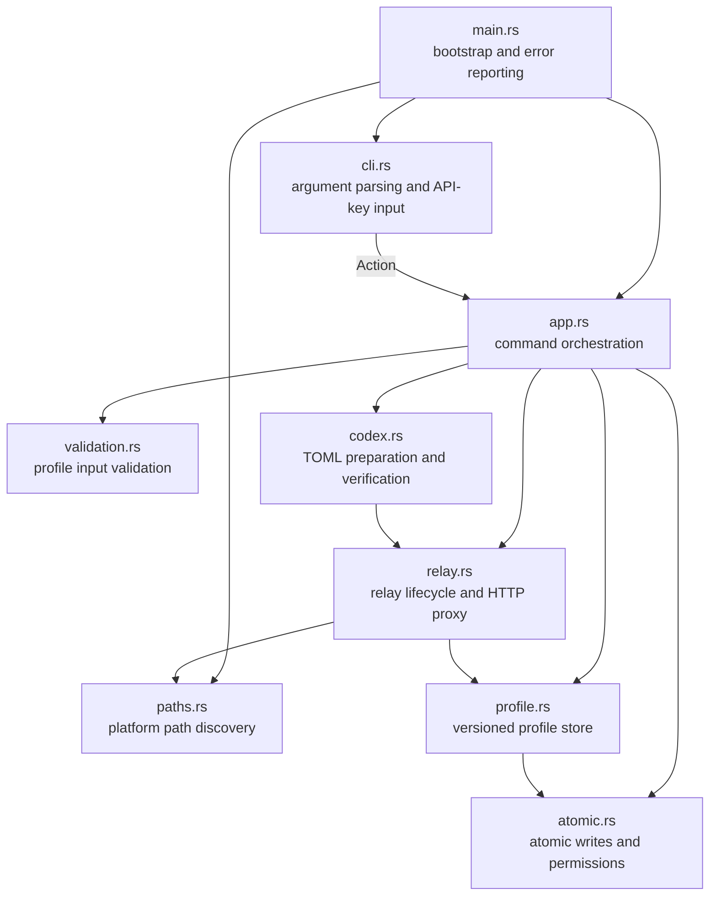
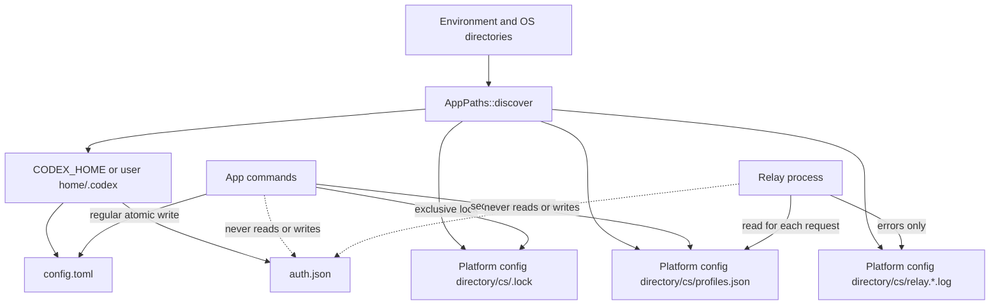
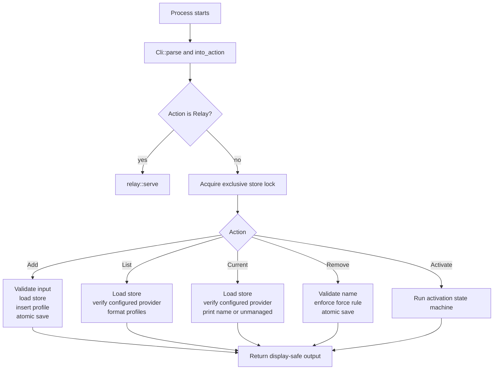
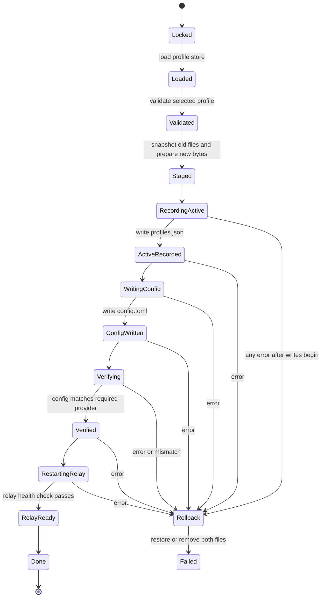
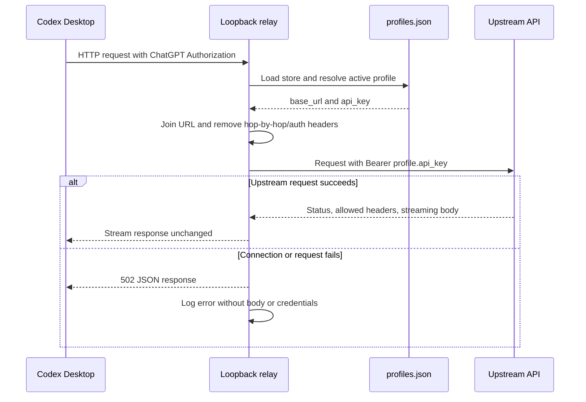
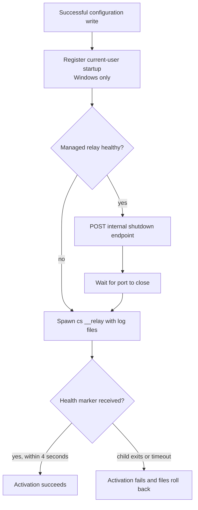

# Architecture

This document describes the structure and runtime behavior of `codex-switch`
(`cs`). It is the source of truth for module responsibilities, persistent data,
and the workflows that change or consume a profile.

## System architecture

`cs` is a single Rust binary with two execution modes:

- An interactive command-line process manages profiles and Codex configuration.
- The hidden `cs __relay` process listens only on `127.0.0.1:14556` and proxies
  Codex model requests to the active profile's upstream API.

The local relay is the trust boundary between Codex's ChatGPT authentication
and the configured upstream. It discards the incoming `Authorization` header,
adds the active profile's API key, and never forwards the ChatGPT access token.

## Module responsibilities

| Module | Responsibility | Important interface |
| --- | --- | --- |
| `main` | Parse, construct dependencies, execute, and print results | `run` |
| `cli` | Convert command-line syntax into domain actions without printing secrets | `Cli::into_action`, `Action` |
| `app` | Coordinate commands, locking, activation, verification, and rollback | `App::execute` |
| `profile` | Load, validate the version of, encode, and save the JSON profile store | `ProfileStore` |
| `codex` | Preserve unrelated TOML while installing and checking the relay provider | `prepare`, `file_matches` |
| `relay` | Restart the managed process, expose health controls, and proxy requests | `RelayManager`, `serve` |
| `atomic` | Write files atomically and apply sensitive-file permissions | `FileWriter` |
| `paths` | Resolve all platform-dependent files from environment and OS directories | `AppPaths` |
| `validation` | Enforce profile name, URL, and API-key constraints | `validate_*` |

`FileWriter` and `RelayManager` are dependency-injection boundaries. Production
uses `RealFileWriter` and `RealRelayManager`; tests replace them to exercise
write failures, relay failures, and rollback behavior deterministically.

## Persistent data

`profiles.json` is a versioned JSON document containing the active profile and
a sorted map of names to base URLs and plaintext API keys. On Unix, the store
directory is mode `0700` and the store is mode `0600`; on Windows it inherits
the current user's local application-data ACL. `config.toml` contains only the
loopback provider configuration, never the upstream URL or profile API key.

All user-facing commands except `__relay` acquire the same exclusive `.lock`
file. Writes use a temporary file plus atomic replacement, and activation keeps
the previous bytes so both modified files can be restored if any later step
fails.

## Command workflow

`current` and the active marker shown by `list` are deliberately verified
values. A name is active only when it exists in the store and `config.toml`
still exactly matches the required relay configuration. External edits therefore
produce `unmanaged` rather than a stale active result.

## Activation state machine

Activation is the only multi-file transaction. Its state machine records the
last attempted phase for diagnostics and determines when rollback is required.

The workflow stages the new store and TOML entirely in memory before writing.
It then records the active profile, writes the Codex configuration, verifies
the file from disk, and restarts the relay. Failure at or after
`RecordingActive` restores the original `profiles.json` and `config.toml`
contents; files that did not previously exist are removed.

## Relay request flow

Redirect following is disabled so credentials are not automatically carried to
another origin. Request headers excluded from forwarding are `authorization`,
connection-specific headers, `host`, content length, and proxy authorization.
Equivalent hop-by-hop response headers are also removed. The body is buffered
for the upstream request; the upstream response body is streamed back to Codex.

## Relay lifecycle

The health and shutdown endpoints are bound to loopback with the relay and are
used only for lifecycle management. The health probe verifies a service marker,
not merely that some process has opened port `14556`.

## Change checklist

When behavior changes, update the corresponding diagram and description here:

- A module or dependency boundary changes: update **System architecture** and
  **Module responsibilities**.
- A file, environment variable, or persistence rule changes: update
  **Persistent data**.
- Command routing or semantics change: update **Command workflow**.
- Activation phases, ordering, or rollback behavior change: update
  **Activation state machine**.
- Proxy headers, authentication, streaming, or lifecycle change: update
  **Relay request flow** or **Relay lifecycle**.
