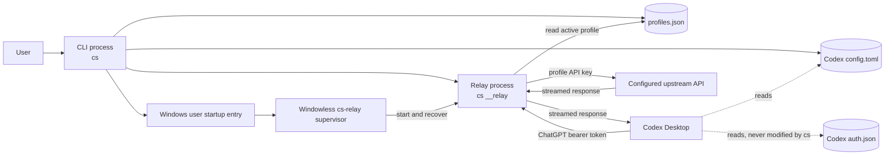
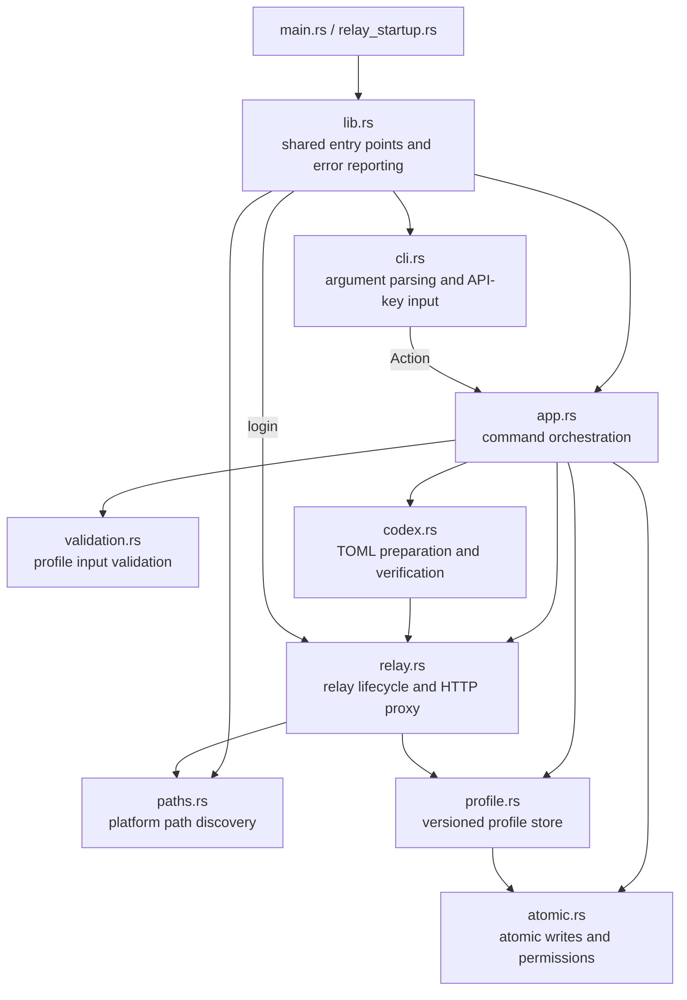
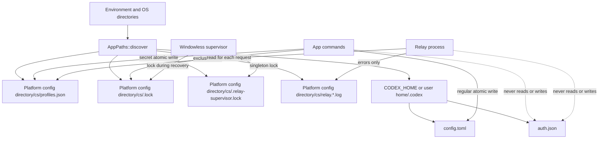
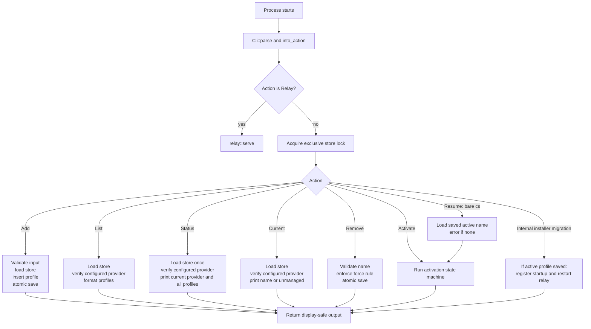
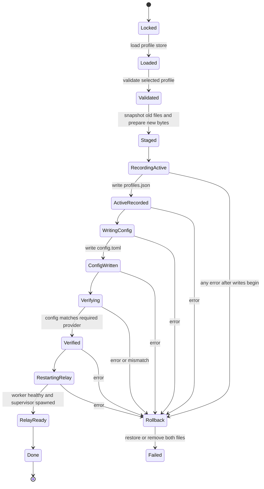
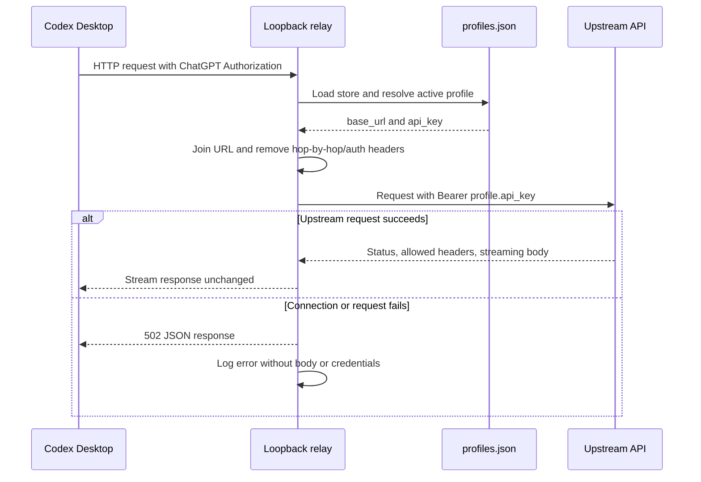
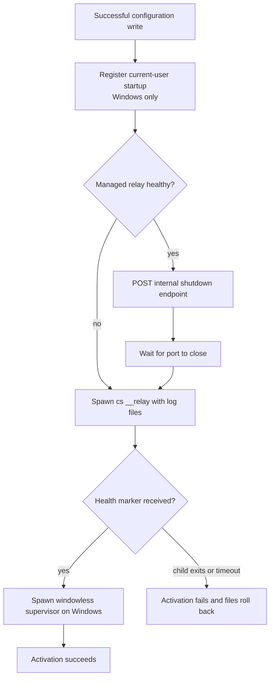
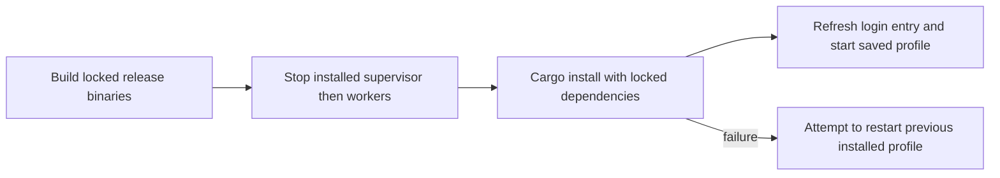

# Architecture

This document describes the structure and runtime behavior of `codex-switch`
(`cs`). It is the source of truth for module responsibilities, persistent data,
and the workflows that change or consume a profile.

## System architecture

`cs` and `cs-relay` share a Rust library with three execution modes:

- An interactive command-line process manages profiles and Codex configuration.
- The hidden `cs __relay` process listens only on `127.0.0.1:14556` and proxies
  Codex model requests to the active profile's upstream API.
- The Windows GUI-subsystem `cs-relay` supervisor runs without a console at
  login, restores the saved profile, and recovers exited workers.

The local relay is the trust boundary between Codex's ChatGPT authentication
and the configured upstream. It discards the incoming `Authorization` header,
adds the active profile's API key, and never forwards the ChatGPT access token.

## Module responsibilities

| Module | Responsibility |
| --- | --- |
| `main`, `relay_startup`, `lib` | Console and windowless entry points; shared dependency construction |
| `cli` | Convert command-line syntax into domain actions without printing secrets |
| `app` | Coordinate commands, status reporting, locking, activation, verification, and rollback |
| `profile` | Load, validate the version of, encode, and save the JSON profile store |
| `codex` | Preserve unrelated TOML while installing and checking the relay provider |
| `relay` | Register login, supervise workers, expose health controls, and proxy requests |
| `atomic` | Write files atomically and apply sensitive-file permissions |
| `paths` | Resolve all platform-dependent files from environment and OS directories |
| `validation` | Enforce profile name, URL, and API-key constraints |

`FileWriter` and `RelayManager` are dependency-injection boundaries. Production
uses `RealFileWriter` and `RealRelayManager`; tests replace them to exercise
write failures, relay failures, and rollback behavior deterministically.

## Persistent data

`profiles.json` is a versioned JSON document containing the last successfully
selected profile in `active` and
a sorted map of names to base URLs and plaintext API keys. On Unix, the store
directory is mode `0700` and the store is mode `0600`; on Windows it inherits
the current user's local application-data ACL. `config.toml` contains only the
loopback provider configuration, never the upstream URL or profile API key.

All commands except the internal `__relay` worker acquire the same exclusive `.lock`
file. Writes use a temporary file plus atomic replacement, and activation keeps
the previous bytes so both modified files can be restored if any later step
fails.

## Command workflow

`current`, `status`, and the active marker shown by `list` are verified values.
A name is active only when it exists in the store and `config.toml` still
exactly matches the required relay configuration. External edits, missing or
malformed TOML, and stale references to deleted profiles therefore produce
`unmanaged` rather than a stale active result. Unreadable files and an invalid
profile store produce errors instead of a status report.

`status` reports the current provider and all saved profiles with their base
URLs and active markers. It uses one loaded store and one verification result
for the summary and table, and shares table formatting with `list`. With no
profiles, it reports `unmanaged` and `No profiles saved.`. Reporting never
writes Codex configuration or profile data, prints API keys, activates a profile,
or restarts the relay; the shared command lock still applies. This verifies
configured selection, not worker health or the desktop's in-memory configuration.

## Activation state machine

Activation is the only multi-file transaction. Its state machine records the
last attempted phase for diagnostics and determines when rollback is required.

The workflow stages the new store and TOML entirely in memory before writing.
It then records the active profile, writes the Codex configuration, verifies
the file from disk, and restarts the relay. Failure at or after
`RecordingActive` restores the original `profiles.json` and `config.toml`
contents; files that did not previously exist are removed.

## Relay request flow

Redirect following is disabled so credentials are not automatically carried to
another origin. Request headers excluded from forwarding are `authorization`,
connection-specific headers, `host`, content length, and proxy authorization.
Equivalent hop-by-hop response headers are also removed. The body is buffered
for the upstream request; the upstream response body is streamed back to Codex.
Each model request runs on its own thread so health and shutdown controls are
not queued behind long model responses. The HTTP client is shared by cloning
its connection pool handle.

## Relay lifecycle

The health and shutdown endpoints are bound to loopback with the relay and are
used only for lifecycle management. The health probe verifies a service marker,
not merely that some process has opened port `14556`.

The Run entry invokes `cs-relay.exe --data-dir <absolute saved directory>`.
Both login and activation use the same worker launch function, with null stdin,
redirected stdout/stderr, and `CREATE_NO_WINDOW` on Windows. Startup registry
commands are hidden too. The Windows installer refreshes this registration and
restarts an already selected profile without rewriting Codex configuration.

```mermaid
stateDiagram-v2
    [*] --> ClaimSupervisor: Windows login or activation
    ClaimSupervisor --> Exit: singleton lock already held
    ClaimSupervisor --> Monitor: singleton lock acquired
    Monitor --> Monitor: port open; check every 2 seconds
    Monitor --> Recover: port closed
    Recover --> Locked: acquire command lock
    Locked --> Monitor: worker returned or no saved active profile
    Locked --> Starting: saved active profile and port closed
    Starting --> Monitor: detached worker passes health check
    Starting --> Backoff: launch fails; log error
    Backoff --> Monitor: retry delay doubles up to 30 seconds
    Exit --> [*]
```

The supervisor uses port liveness for ongoing monitoring and the identity health
check for new-worker readiness. It releases the command lock between recovery
attempts so normal profile switching stays available. Duplicate supervisors exit
immediately. A startup timeout terminates and reaps its own incomplete worker
before another recovery attempt. The last successful profile stays in the store
across process exits and reboot; bare `cs` loads that name and uses the ordinary
activation transaction. Removing or replacing the active profile clears it.

## Change checklist

When behavior changes, update the corresponding diagram and description here:

- A module or dependency boundary changes: update **System architecture** and
  **Module responsibilities**.
- A file, environment variable, or persistence rule changes: update
  **Persistent data**.
- Command routing or semantics change: update **Command workflow**.
- Activation phases, ordering, or rollback behavior change: update
  **Activation state machine**.
- Proxy headers, authentication, streaming, or lifecycle change: update
  **Relay request flow** or **Relay lifecycle**.
